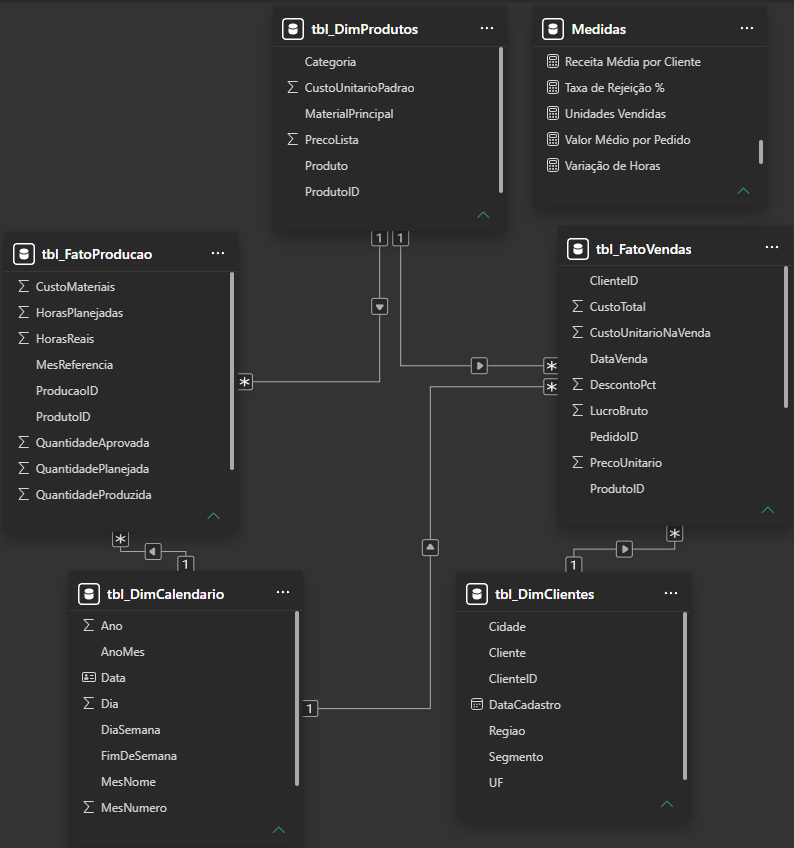

# MetalWorks Industrial | Business Intelligence

Dashboard interativo desenvolvido no Power BI para análise de desempenho comercial e operacional de uma indústria fictícia.

> **Aviso:** A MetalWorks Industrial é uma empresa fictícia. Todos os dados utilizados neste projeto são 100% sintéticos, gerados exclusivamente para fins educacionais e de portfólio.

## Sobre o projeto

O projeto apresenta uma solução de Business Intelligence voltada à análise integrada de indicadores comerciais e operacionais.

O dashboard permite acompanhar resultados de vendas, receita, lucratividade, desempenho de produtos e clientes, além de indicadores relacionados à produção e à qualidade.

O objetivo é transformar dados estruturados em informações visuais que facilitem a identificação de padrões e o acompanhamento do desempenho da empresa.

**Período analisado:** Janeiro de 2025 a dezembro de 2026.

## Dashboard

O relatório foi organizado em três páginas, cada uma com um foco de análise.

### 1. Visão Executiva

Apresenta os principais indicadores de desempenho comercial e operacional, oferecendo uma visão geral dos resultados da empresa.


### 2. Análise Comercial

Explora o desempenho das vendas, incluindo receita líquida, lucro bruto, margem, produtos, clientes e segmentos comerciais.


### 3. Análise Operacional

Apresenta indicadores de produção, qualidade, cumprimento do planejamento e horas planejadas e reais.


## Principais resultados

| Indicador | Resultado |
|---|---:|
| Receita líquida | R$ 18,05 milhões |
| Lucro bruto | R$ 6,72 milhões |
| Margem bruta | 37,19% |
| Quantidade de pedidos | 1.401 |
| Unidades vendidas | 11.006 |
| Taxa de rejeição | 3,19% |
| Cumprimento do planejamento | 102,18% |

Entre os resultados observados, os segmentos comerciais apresentam participação relativamente equilibrada na receita, com percentuais entre 23,6% e 26,1%. O produto **Bancada de trabalho 2 m** se destaca como o de maior receita no cenário analisado, com aproximadamente R$ 2,50 milhões.

## Modelo de dados

O projeto utiliza um modelo dimensional composto por duas tabelas fato e três tabelas dimensão, permitindo análises comerciais e operacionais integradas por meio das dimensões compartilhadas.

### Diagrama de relacionamentos



*Modelo dimensional desenvolvido no Power BI Desktop.*

### Estrutura das tabelas

**Tabelas dimensão:**
- `tbl_DimProdutos`: 12 produtos.
- `tbl_DimClientes`: 40 clientes fictícios.
- `tbl_DimCalendario`: 730 registros de datas, abrangendo 2025 e 2026.

**Tabelas fato:**
- `tbl_FatoVendas`: 2.800 registros de vendas.
- `tbl_FatoProducao`: 288 registros de produção, organizados por produto e mês.

### Relacionamentos

- `tbl_DimCalendario[Data]` → `tbl_FatoVendas[DataVenda]`
- `tbl_DimCalendario[Data]` → `tbl_FatoProducao[MesReferencia]`
- `tbl_DimProdutos[ProdutoID]` → `tbl_FatoVendas[ProdutoID]`
- `tbl_DimProdutos[ProdutoID]` → `tbl_FatoProducao[ProdutoID]`
- `tbl_DimClientes[ClienteID]` → `tbl_FatoVendas[ClienteID]`

O modelo utiliza relacionamentos ativos de um para muitos (`1:*`), com direção de filtragem única.

**Observação sobre o calendário:** o relacionamento entre `tbl_DimCalendario[Data]` e `tbl_FatoProducao[MesReferencia]` utiliza o primeiro dia de cada mês como referência para os registros mensais de produção.

## Tecnologias e ferramentas

- **Power BI Desktop:** desenvolvimento do dashboard e visualização dos dados.
- **DAX:** criação de medidas e indicadores calculados.
- **Microsoft Excel:** organização e estruturação da base de dados.
- **GitHub:** versionamento e documentação do projeto.

## Estrutura do repositório

```text
metalworks-industrial-power-bi/
│
├── Dashboard/
│   └── MetalWorks_Industrial.pbix
│
├── Dados/
│   └── MetalWorks_Base_PowerBI.xlsx
│
├── Prints/
│   ├── analise-comercial.png
│   ├── analise-operacional.png
│   ├── modelo-dados.png
│   └── visao-executiva.png
│
└── README.md
```

## Como abrir o projeto

1. Baixe o arquivo `MetalWorks_Industrial.pbix`, disponível na pasta `Dashboard`.
2. Abra o arquivo no Power BI Desktop para visualizar e explorar o dashboard.
3. A base de dados original, `MetalWorks_Base_PowerBI.xlsx`, está disponível na pasta `Dados` para consulta e reprodução do projeto.

## Observações e limitações

- Os valores de custos e resultados foram gerados para simular um cenário empresarial.
- A base não possui uma tabela de estoque. Portanto, não é possível estabelecer uma relação direta entre a quantidade produzida e a quantidade vendida, nem atribuir as diferenças entre elas à movimentação de estoque.
- Os dados de produção estão agregados por produto e mês, enquanto os registros de vendas estão organizados por item de pedido.

## Autoria

**Camila Alvarenga Enseñat**
