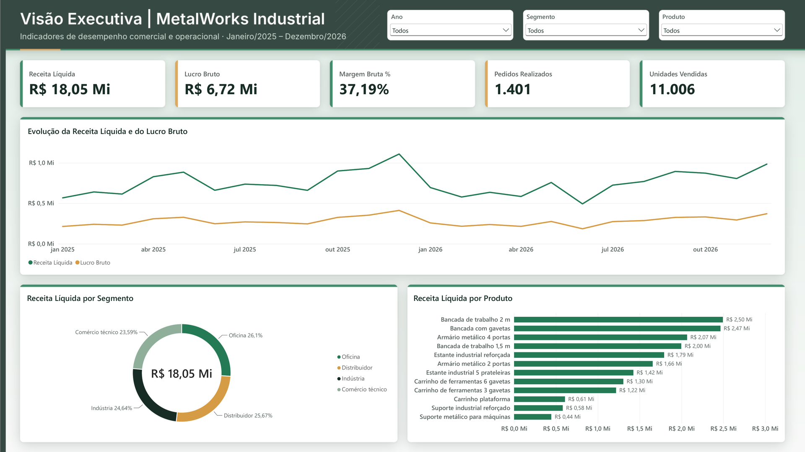
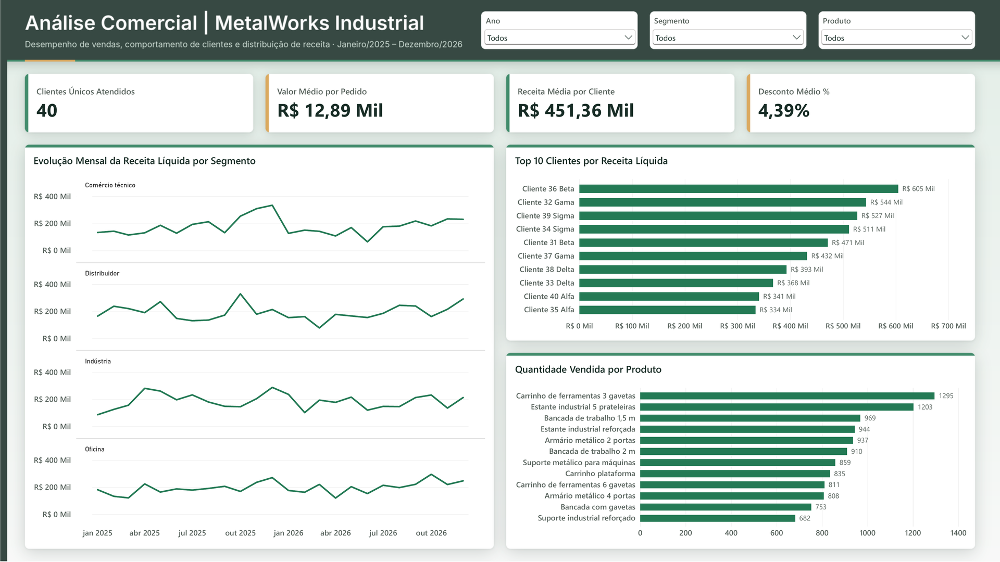
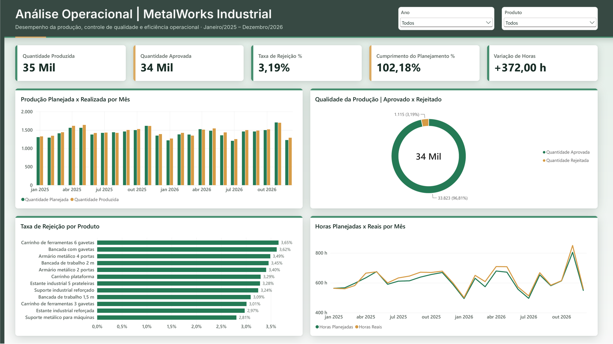

# MetalWorks Industrial | Business Intelligence

Dashboard interativo desenvolvido em Power BI para análise de desempenho comercial e operacional de uma indústria fictícia.

## Sobre o projeto

Este projeto apresenta uma solução de Business Intelligence voltada à análise integrada de indicadores comerciais e operacionais, permitindo explorar resultados de vendas, desempenho produtivo e indicadores de qualidade.

A proposta é transformar dados estruturados em informações visuais que facilitem a interpretação de resultados e apoiem a tomada de decisões.

**Aviso:** a MetalWorks Industrial é uma empresa fictícia e todos os dados utilizados foram gerados artificialmente para fins educacionais e de portfólio.

## Dashboard

O relatório está dividido em três páginas:

### 1. Visão Executiva



Visão geral dos principais indicadores de desempenho comercial e operacional.

### 2. Análise Comercial



Exploração dos resultados de vendas, receita, lucratividade, clientes e produtos.

### 3. Análise Operacional



Análise de produção, cumprimento do planejamento, horas trabalhadas e indicadores de qualidade.

## Principais indicadores

**Comercial**
- Receita líquida
- Custo das vendas
- Lucro e margem bruta
- Quantidade vendida e número de pedidos
- Desempenho por cliente, produto e segmento

**Operacional**
- Quantidade produzida e aprovada
- Taxa de rejeição
- Cumprimento do planejamento de produção
- Horas planejadas e realizadas
- Custo de materiais

## Tecnologias e ferramentas

- **Power BI Desktop:** desenvolvimento do dashboard e visualização dos dados.
- **DAX:** criação de medidas e indicadores.
- **Microsoft Excel:** organização e estruturação da base de dados.
- **GitHub:** versionamento e documentação do projeto.

## Estrutura do repositório

```text
metalworks-industrial-power-bi/
├── Dashboard/
│   └── MetalWorks_Industrial.pbix
├── Dados/
│   └── MetalWorks_Base_Dados.xlsx
├── Prints/
│   ├── visao-executiva.png
│   ├── analise-comercial.png
│   └── analise-operacional.png
└── README.md
```

## Base de dados

A base foi desenvolvida especificamente para este projeto, com dados fictícios referentes ao período de janeiro de 2025 a dezembro de 2026.

O arquivo Excel contém tabelas dimensionais e fatos organizadas para utilização no Power BI, incluindo informações de produtos, clientes, vendas, produção e calendário.

## Observações e limitações

Os indicadores apresentados representam um cenário simulado. A base não contém informações de estoque, portanto não permite estabelecer uma relação direta entre quantidades produzidas e vendidas ou atribuir diferenças a movimentações de estoque.

---

**Projeto autoral desenvolvido para fins educacionais e de portfólio.**
